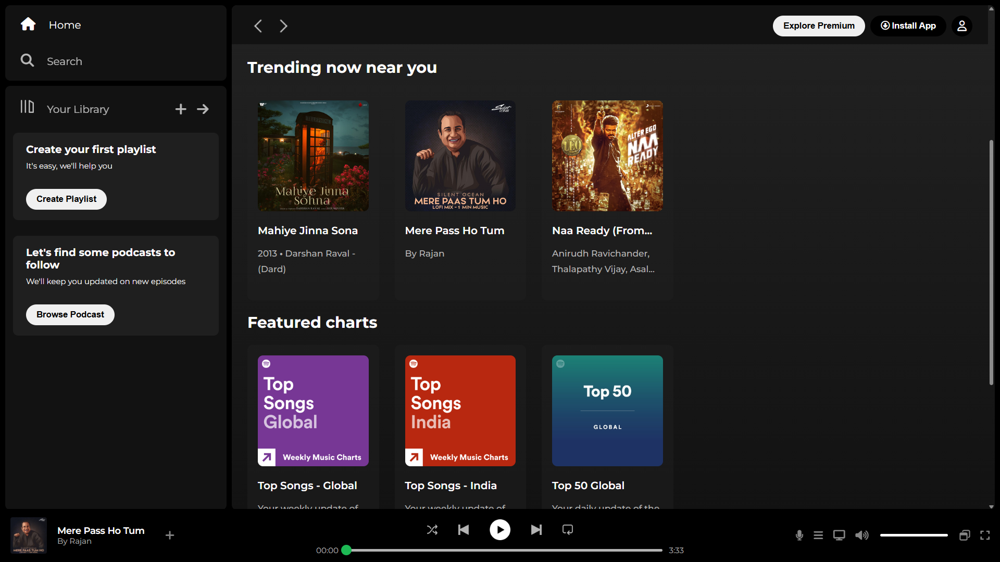

# Spotify Clone - Web Player 🎵

A fully responsive **Spotify Web Player clone** built as my first web development project.
This project focuses on recreating the user interface of Spotify’s web player using **semantic HTML** and **custom CSS styling**.

## 🚀 Live Demo

[View Live Project](https://yashik02.github.io/spotify-clone-v1/)

## ✨ Features

* **Custom UI Layout:** Recreated Spotify’s sidebar, main content area, and music player bar using **CSS Flexbox**.
* **Responsive Design:** Includes media queries to hide selected elements on smaller screens (`max-width: 1000px`).
* **Interactive Elements:** Smooth hover effects on cards, navigation items, and buttons for a realistic user experience.
* **Sticky Navigation:** Implemented a sticky header for better navigation within the main content area.
* **Custom Styling:** Used CSS variables for consistent theme colors and **Google Fonts (Montserrat)** for typography.

## 🛠️ Built With

* **HTML5** — Semantic structure
* **CSS3** — Flexbox, CSS Variables, Linear Gradients
* **Font Awesome** — Icons
* **Google Fonts** — Montserrat, Poppins

## 📸 Preview



## 🚦 Getting Started

1. Clone the repository:

   ```bash
   git clone https://github.com/Yashik02/spotify-clone-v1.git
   ```

2. Open `index.html` in your browser.

## 👨‍💻 Author

Created with ❤️ by **Yashik Bandhu**
